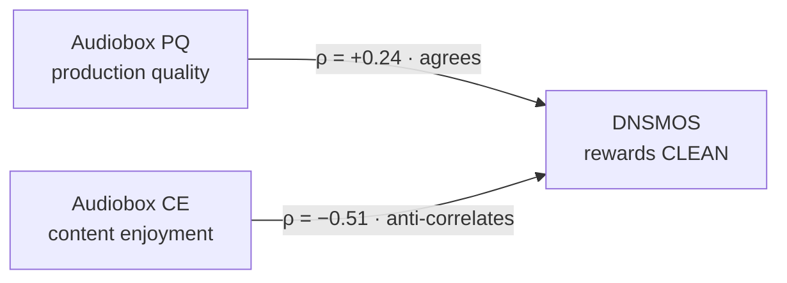

<style>
/* Theme is ngera/caliper-pages: content sits in <article class="prose">.
   article.prose beats the theme's own .prose rules on specificity, so no
   !important is needed. Colour comes from Caliper's --accent token, so it
   follows light/dark and the accent switcher instead of being pinned. */
article.prose h1,
article.prose h2,
article.prose h3,
article.prose h4 { color: var(--accent); }
</style>

# Which voice AI vendor should you use?

**An independent evaluation of eight commercial text-to-speech vendors — and why that question has no single answer.**

*Neeraj Gera · findings as of 2026-09-01 · ~10 minute read*

---

## What is this research?

I measured eight commercial text-to-speech vendors against the same audio, on the same days, under rules committed before the data existed.

The question: **does the industry habit of quoting one "quality score" per vendor survive contact with evidence?**

It does not.

Two peer-reviewed machine quality raters — Meta's Audiobox Aesthetics and Microsoft's DNSMOS — scored identical audio from the same campaign and **ranked the eight vendors differently**:

| Rank correlation between the two raters | Campaign 1 | Campaign 2 |
|---|---:|---:|
| Conversational | −0.134 | −0.143 |
| Narration | −0.271 | −0.220 |

- **Zero** would mean the two raters are unrelated.
- **Negative** means the vendors one liked were faintly the ones the other didn't.
- Neither model is broken. They measure different things.
- Almost nobody quoting a vendor quality number has checked which thing theirs measures.

That finding is the spine of the project. Everything else exists to answer the question a buyer actually has — not *"who wins"* but *"which difference is real, and which one matters for what I'm building."*

Solo, self-funded. No vendor sponsored, reviewed, or previewed it.

---

## What was the scope?

### The roster

| Vendor | Model tested | Why it was selected |
|---|---|---|
| ElevenLabs | `eleven_flash_v2_5` · `eleven_multilingual_v2` | Market-reputation leader |
| OpenAI | `gpt-4o-mini-tts` · `tts-1-hd` | LLM-ecosystem default |
| Google Cloud | `Chirp3-HD` | Hyperscaler |
| Deepgram | `aura-2` | Voice-agent specialist |
| Cartesia | `sonic-2` | Latency-optimised |
| Fish Audio | `s2.1-pro` | Low-cost challenger |
| Speechify | `simba-3.2` | Consumer-scale |
| Canopy Orpheus | `orpheus-3b` on Replicate | Open-weights / self-hosted |

> **Read the model, not just the vendor.** Vendors ship several models and I tested the one a buyer would plausibly deploy for each job. So **ElevenLabs and OpenAI ran different models for the two use cases**, and **Fish ran a different model for latency than for quality** — a vendor's two rows are not always the same deployment. Column above reflects selection rationale, not a result.

### The design

| | |
|---|---|
| **Use cases** | Conversational (short turns, latency-sensitive) · Narration (long-form, quality-sensitive) |
| **Corpus** | 75 items per use case, six strata: short, medium, long, jargon, edge cases, contamination probe |
| **Campaigns** | Two, three weeks apart — 1,200 files, then 1,199 |
| **Total audio scored** | 2,399 files |

### In and out

| In scope | Out of scope |
|---|---|
| English | Any other language |
| One voice per vendor per use case | Voice-library sweeps |
| Public paid tiers | Enterprise contracts |
| Text-to-speech | Speech-to-text, conversational agents |

---

## How it was done?


### The method choices that matter

| Choice | Why |
|---|---|
| **Pre-registration with git tags** | 11 tags, each predating the result it judges. A convenient-looking finding can be checked against the tag that came first. |
| **Two independent quality pipelines** | If they agree, the ranking is robust to the instrument. If they disagree, "quality" isn't one thing — more useful than a confident ranking. |
| **Two ASR judges, independence enforced in code** | WER from one recognizer measures the *pair*, not the speaker. Judges must differ in organisation, encoder family, and training pipeline — a validator refuses a run that violates it. No recognizer from a vendor under test. |
| **Loudness normalised first** | Louder reliably sounds better, to models as well as people. Skip it and you benchmark mastering. |
| **Gates, not a weighted composite** | I built a composite, then deleted it. Averaging axes that anti-correlate hides a decision instead of making one. |
| **Measured my own noise floor** | 10 items × 3 draws × 6 vendors, so the study can say which differences it is *not* entitled to report. |
| **Contamination probe** | 15 items per use case of Harvard sentences and public-domain openings — text models may have trained on. |
| **Recompute and diff** | Every published number recalculated from committed JSON, then compared against the sentence reporting it. |

### Two things the audit turned up

- **The probe works.** Probe items transcribe at **2.6% / 2.8%** error against roughly **14%** for the authored corpus — evidence the corpus is doing real work and the pipeline isn't broken.
- **The measurement layer never failed; the reporting layer did.** Recomputation reproduced perfectly every pass. The ~198 retractions in `CORRECTIONS.md` are all reporting errors — the most transferable finding here about how evaluations go wrong.

---

## What was measured?

| | Dimension | What it captures | Status |
|---|---|---|---|
| **D1** | Latency | Time to first audio, 50 serial trials × 6 sessions over 4 dates; real-time factor | Executed |
| **D2** | Intelligibility | Word error rate via two-judge agreement | Executed |
| **D3** | Quality | Six signals, two pipelines — Audiobox PQ/CE, DNSMOS P.808 + P.835 triad | Executed |
| **D4** | Human preference | Blinded pairwise, Bradley–Terry ranking | **Designed, not run** |
| **D5** | Audio hygiene | Clipping, loudness, noise floor | Executed |
| **D6** | Cost | Published rates, normalised to $/1K words at three volumes | Executed |
| **D7** | Developer experience | Integration friction log | Published; timings descoped |
| **D8** | Capabilities | Desk-research matrix of commercial + technical properties | 65 of 80 cells |

**One note on D1.** Every latency figure is a **cold call from a residential connection**, with DNS lookup, connection setup, TLS handshake and request upload inside the interval.

- Fair stand-in for what a request from a user's own machine costs.
- **Not** the quantity most published latency numbers report.
- The difference is a roughly constant amount added to every call, not random noise.

---

## What were the key findings?

### 1 · The two raters disagree, and the disagreement is structural

On **conversational** audio the split decomposes cleanly:



- DNSMOS rewards **clean**. Audiobox CE rewards **warm**.
- A voice engineered to sound intimate loses points for exactly the quality that makes it appealing.

**That story is only half true.** On **narration** the decomposition collapses — production quality comes out mixed-sign at **−0.17**. The clean-versus-warm reading is a **conversational-only** result. Writing it up as a general law would have been the most quotable paragraph in the study.

#### The inversion, vendor by vendor


*Each vendor appears twice — ranked by the warm rater on the left, the clean rater on the right. Red lines mark a swing of four ranks or more. Rendered from the **replication campaign**; the source run and render date are stamped in the figure footer.*

The same finding as exact ranks, from the **baseline campaign**. All six quality signals, narration use case. **1 = best, 8 = worst.** Rows sorted by the first column.

<table style="border-collapse:collapse;display:table;margin:0 0 6px;">
<thead><tr>
<th style="padding:7px 10px;border:1px solid var(--line);font-size:13px;text-align:left;color:var(--fg-3);text-transform:uppercase;letter-spacing:.06em;font-size:11px;">Vendor</th>
<th style="padding:7px 10px;border:1px solid var(--line);font-size:13px;text-align:center;color:var(--fg-3);text-transform:uppercase;letter-spacing:.06em;font-size:11px;">AB.PQ</th>
<th style="padding:7px 10px;border:1px solid var(--line);font-size:13px;text-align:center;color:var(--fg-3);text-transform:uppercase;letter-spacing:.06em;font-size:11px;">AB.CE</th>
<th style="padding:7px 10px;border:1px solid var(--line);font-size:13px;text-align:center;color:var(--fg-3);text-transform:uppercase;letter-spacing:.06em;font-size:11px;">DN.p808</th>
<th style="padding:7px 10px;border:1px solid var(--line);font-size:13px;text-align:center;color:var(--fg-3);text-transform:uppercase;letter-spacing:.06em;font-size:11px;">DN.ovrl</th>
<th style="padding:7px 10px;border:1px solid var(--line);font-size:13px;text-align:center;color:var(--fg-3);text-transform:uppercase;letter-spacing:.06em;font-size:11px;">DN.sig</th>
<th style="padding:7px 10px;border:1px solid var(--line);font-size:13px;text-align:center;color:var(--fg-3);text-transform:uppercase;letter-spacing:.06em;font-size:11px;">DN.bak</th>
</tr></thead><tbody>
<tr>
<td style="padding:7px 10px;border:1px solid var(--line);font-size:13px;font-weight:600;white-space:nowrap;color:var(--fg);">Speechify</td>
<td style="padding:7px 10px;border:1px solid var(--line);font-size:13px;text-align:center;font-weight:600;background:#bfe8cc;color:#16202a;">1</td>
<td style="padding:7px 10px;border:1px solid var(--line);font-size:13px;text-align:center;font-weight:600;background:#bfe8cc;color:#16202a;">1</td>
<td style="padding:7px 10px;border:1px solid var(--line);font-size:13px;text-align:center;font-weight:600;background:#f9d0a8;color:#16202a;">6</td>
<td style="padding:7px 10px;border:1px solid var(--line);font-size:13px;text-align:center;font-weight:600;background:#f4f1b8;color:#16202a;">4</td>
<td style="padding:7px 10px;border:1px solid var(--line);font-size:13px;text-align:center;font-weight:600;background:#fae3b0;color:#16202a;">5</td>
<td style="padding:7px 10px;border:1px solid var(--line);font-size:13px;text-align:center;font-weight:600;background:#e4f1bd;color:#16202a;">3</td>
</tr>
<tr>
<td style="padding:7px 10px;border:1px solid var(--line);font-size:13px;font-weight:600;white-space:nowrap;color:var(--fg);">Orpheus</td>
<td style="padding:7px 10px;border:1px solid var(--line);font-size:13px;text-align:center;font-weight:600;background:#d2eec4;color:#16202a;">2</td>
<td style="padding:7px 10px;border:1px solid var(--line);font-size:13px;text-align:center;font-weight:600;background:#f6bba4;color:#16202a;">7</td>
<td style="padding:7px 10px;border:1px solid var(--line);font-size:13px;text-align:center;font-weight:600;background:#f4f1b8;color:#16202a;">4</td>
<td style="padding:7px 10px;border:1px solid var(--line);font-size:13px;text-align:center;font-weight:600;background:#d2eec4;color:#16202a;">2</td>
<td style="padding:7px 10px;border:1px solid var(--line);font-size:13px;text-align:center;font-weight:600;background:#f4f1b8;color:#16202a;">4</td>
<td style="padding:7px 10px;border:1px solid var(--line);font-size:13px;text-align:center;font-weight:600;background:#bfe8cc;color:#16202a;">1</td>
</tr>
<tr>
<td style="padding:7px 10px;border:1px solid var(--line);font-size:13px;font-weight:600;white-space:nowrap;color:var(--fg);">Cartesia</td>
<td style="padding:7px 10px;border:1px solid var(--line);font-size:13px;text-align:center;font-weight:600;background:#e4f1bd;color:#16202a;">3</td>
<td style="padding:7px 10px;border:1px solid var(--line);font-size:13px;text-align:center;font-weight:600;background:#fae3b0;color:#16202a;">5</td>
<td style="padding:7px 10px;border:1px solid var(--line);font-size:13px;text-align:center;font-weight:600;background:#bfe8cc;color:#16202a;">1</td>
<td style="padding:7px 10px;border:1px solid var(--line);font-size:13px;text-align:center;font-weight:600;background:#f2a7a2;color:#16202a;">8</td>
<td style="padding:7px 10px;border:1px solid var(--line);font-size:13px;text-align:center;font-weight:600;background:#f2a7a2;color:#16202a;">8</td>
<td style="padding:7px 10px;border:1px solid var(--line);font-size:13px;text-align:center;font-weight:600;background:#f2a7a2;color:#16202a;">8</td>
</tr>
<tr>
<td style="padding:7px 10px;border:1px solid var(--line);font-size:13px;font-weight:600;white-space:nowrap;color:var(--fg);">Google</td>
<td style="padding:7px 10px;border:1px solid var(--line);font-size:13px;text-align:center;font-weight:600;background:#f4f1b8;color:#16202a;">4</td>
<td style="padding:7px 10px;border:1px solid var(--line);font-size:13px;text-align:center;font-weight:600;background:#e4f1bd;color:#16202a;">3</td>
<td style="padding:7px 10px;border:1px solid var(--line);font-size:13px;text-align:center;font-weight:600;background:#f6bba4;color:#16202a;">7</td>
<td style="padding:7px 10px;border:1px solid var(--line);font-size:13px;text-align:center;font-weight:600;background:#f9d0a8;color:#16202a;">6</td>
<td style="padding:7px 10px;border:1px solid var(--line);font-size:13px;text-align:center;font-weight:600;background:#f6bba4;color:#16202a;">7</td>
<td style="padding:7px 10px;border:1px solid var(--line);font-size:13px;text-align:center;font-weight:600;background:#fae3b0;color:#16202a;">5</td>
</tr>
<tr>
<td style="padding:7px 10px;border:1px solid var(--line);font-size:13px;font-weight:600;white-space:nowrap;color:var(--fg);">ElevenLabs</td>
<td style="padding:7px 10px;border:1px solid var(--line);font-size:13px;text-align:center;font-weight:600;background:#fae3b0;color:#16202a;">5</td>
<td style="padding:7px 10px;border:1px solid var(--line);font-size:13px;text-align:center;font-weight:600;background:#d2eec4;color:#16202a;">2</td>
<td style="padding:7px 10px;border:1px solid var(--line);font-size:13px;text-align:center;font-weight:600;background:#fae3b0;color:#16202a;">5</td>
<td style="padding:7px 10px;border:1px solid var(--line);font-size:13px;text-align:center;font-weight:600;background:#f6bba4;color:#16202a;">7</td>
<td style="padding:7px 10px;border:1px solid var(--line);font-size:13px;text-align:center;font-weight:600;background:#f9d0a8;color:#16202a;">6</td>
<td style="padding:7px 10px;border:1px solid var(--line);font-size:13px;text-align:center;font-weight:600;background:#f6bba4;color:#16202a;">7</td>
</tr>
<tr>
<td style="padding:7px 10px;border:1px solid var(--line);font-size:13px;font-weight:600;white-space:nowrap;color:var(--fg);">Deepgram</td>
<td style="padding:7px 10px;border:1px solid var(--line);font-size:13px;text-align:center;font-weight:600;background:#f9d0a8;color:#16202a;">6</td>
<td style="padding:7px 10px;border:1px solid var(--line);font-size:13px;text-align:center;font-weight:600;background:#f4f1b8;color:#16202a;">4</td>
<td style="padding:7px 10px;border:1px solid var(--line);font-size:13px;text-align:center;font-weight:600;background:#e4f1bd;color:#16202a;">3</td>
<td style="padding:7px 10px;border:1px solid var(--line);font-size:13px;text-align:center;font-weight:600;background:#e4f1bd;color:#16202a;">3</td>
<td style="padding:7px 10px;border:1px solid var(--line);font-size:13px;text-align:center;font-weight:600;background:#d2eec4;color:#16202a;">2</td>
<td style="padding:7px 10px;border:1px solid var(--line);font-size:13px;text-align:center;font-weight:600;background:#f4f1b8;color:#16202a;">4</td>
</tr>
<tr>
<td style="padding:7px 10px;border:1px solid var(--line);font-size:13px;font-weight:600;white-space:nowrap;color:var(--fg);">Fish</td>
<td style="padding:7px 10px;border:1px solid var(--line);font-size:13px;text-align:center;font-weight:600;background:#f6bba4;color:#16202a;">7</td>
<td style="padding:7px 10px;border:1px solid var(--line);font-size:13px;text-align:center;font-weight:600;background:#f9d0a8;color:#16202a;">6</td>
<td style="padding:7px 10px;border:1px solid var(--line);font-size:13px;text-align:center;font-weight:600;background:#d2eec4;color:#16202a;">2</td>
<td style="padding:7px 10px;border:1px solid var(--line);font-size:13px;text-align:center;font-weight:600;background:#fae3b0;color:#16202a;">5</td>
<td style="padding:7px 10px;border:1px solid var(--line);font-size:13px;text-align:center;font-weight:600;background:#e4f1bd;color:#16202a;">3</td>
<td style="padding:7px 10px;border:1px solid var(--line);font-size:13px;text-align:center;font-weight:600;background:#f9d0a8;color:#16202a;">6</td>
</tr>
<tr>
<td style="padding:7px 10px;border:1px solid var(--line);font-size:13px;font-weight:600;white-space:nowrap;color:var(--fg);">OpenAI</td>
<td style="padding:7px 10px;border:1px solid var(--line);font-size:13px;text-align:center;font-weight:600;background:#f2a7a2;color:#16202a;">8</td>
<td style="padding:7px 10px;border:1px solid var(--line);font-size:13px;text-align:center;font-weight:600;background:#f2a7a2;color:#16202a;">8</td>
<td style="padding:7px 10px;border:1px solid var(--line);font-size:13px;text-align:center;font-weight:600;background:#f2a7a2;color:#16202a;">8</td>
<td style="padding:7px 10px;border:1px solid var(--line);font-size:13px;text-align:center;font-weight:600;background:#bfe8cc;color:#16202a;">1</td>
<td style="padding:7px 10px;border:1px solid var(--line);font-size:13px;text-align:center;font-weight:600;background:#bfe8cc;color:#16202a;">1</td>
<td style="padding:7px 10px;border:1px solid var(--line);font-size:13px;text-align:center;font-weight:600;background:#d2eec4;color:#16202a;">2</td>
</tr>
</tbody></table>

<p style="font-size:12px;color:var(--fg-3);margin:0 0 4px;">Shaded best&nbsp;(1) to worst&nbsp;(8). The rank number carries the signal; colour only reinforces it.</p>

> Chart and table come from **different campaigns**, three weeks apart, so mid-table ordering differs slightly between them. The three rows below hold in both.

**What each column means**

| Column | Rater | What it scores |
|---|---|---|
| **AB.PQ** | Meta Audiobox | **Production quality** — technical cleanliness. The closest available proxy for "does this sound professionally produced". |
| **AB.CE** | Meta Audiobox | **Content enjoyment** — a warmth and pleasantness judgment, closer to listener preference than to engineering quality. |
| **DN.p808** | Microsoft DNSMOS | **ITU-T P.808** — one overall listening-quality score, trained against crowd ratings of whole clips. |
| **DN.ovrl** | Microsoft DNSMOS | **P.835 overall** — the headline score of the three-scale standard. |
| **DN.sig** | Microsoft DNSMOS | **P.835 signal** — distortion in the speech itself, judged separately from anything behind it. |
| **DN.bak** | Microsoft DNSMOS | **P.835 background** — how intrusive the background is, judged independently of the voice. |

The first **two** columns come from one rater. The last **four** come from the other. That block structure is the point — read the table left-to-right and the ordering reshuffles as you cross the boundary.

**Three rows worth reading closely** — each holds in both campaigns

| Vendor | What it does | Baseline | Replication |
|---|---|---|---|
| **OpenAI** | Last on both Audiobox axes, first on two DNSMOS axes. Technically pristine; Audiobox hears it as unengaging. | PQ #8, CE #8, OVRL #1, SIG #1 | PQ #7, CE #8, OVRL #1, SIG #1 |
| **Speechify** | First on both Audiobox axes, mid-pack on DNSMOS. Warm and engaging; DNSMOS gives no credit for that. | PQ #1, CE #1 | PQ #1, CE #1 |
| **Cartesia** | Top on P.808, bottom on the P.835 triad. The triad detects the clipping; P.808 does not. | p808 #1, OVRL/SIG/BAK #8 | p808 #2, OVRL #8, SIG #8, BAK #7 |

> Cartesia's DNSMOS row is computed over a **survivor subset** — 38 of 75 files, with the rest refused outright for peak-out-of-range (see finding 6). Google's is 71 of 75. Treat both as less certain than the others.

An aggregate "quality score" averages this table into a single column and hides every inversion in it. That is why this project reports six signals rather than one.

### 2 · There is no universal winner

| Axis | Winner | Both use cases? |
|---|---|---|
| Audiobox production quality | **Speechify** | Yes |
| DNSMOS overall | **OpenAI** | Yes |
| Intelligibility (conversational) | **No winner** — OpenAI 13.70% / Fish 13.78%, inside the noise floor | — |

Two vendors each win an entire rater, and the table above shows them winning it at the other's expense.

> Pick the pipeline matching the construct your listeners reward — or read both.

### 3 · Three pre-registered gates were failed by the entire roster

| Gate | Outcome |
|---|---|
| Intelligibility threshold | **Failed all 8** |
| Response time < 400 ms | **Failed all 4 measured** — best 461 ms |
| Real-time factor ≥ 3.0 | 5 pass · 3 fail — first gate to discriminate |
| No clipping (conversational) | 6 pass · 2 fail |
| Noise floor ≤ −40 dBFS | 6 pass · 2 fail, then 5 · 3 |

Reporting a threshold nobody met beats quietly relaxing it. The response-time verdict is bounded by the cold-call measurement above — not a claim that 400 ms is unreachable.

### 4 · The cheapest vendor on paper is not cheap

Orpheus shows **$0.030** per 1,000 words in the cost model.

- Measured per call, the honest figure is **$0.067–0.088** — peer-priced to OpenAI.
- Truncates output at exactly **14.59 seconds**, cutting short 27 of 75 narration items.
- Worst intelligibility on the roster at **26.9%**.

### 5 · Cost ordering inverts across volume

| Vendor | @ 10K words/mo | @ 100K | @ 1M |
|---|---:|---:|---:|
| OpenAI · Fish | **$0.075** | **$0.075** | $0.075 |
| Speechify | $1.000 | $0.100 | **$0.040** |
| Deepgram · Google | $0.150 | $0.150 | $0.150 |
| Cartesia | $0.500 | $0.160 | $0.196 |
| ElevenLabs | $2.200 | $0.220 | $0.244 |

- Speechify is **cheapest at 1M words and second-most-expensive at 10K** — a flat monthly minimum dominates at low volume.
- ElevenLabs is **29× Speechify** at low volume, **6×** at high volume.
- Match the pricing model to your actual usage, not to the headline rate.

### 6 · One vendor's audio breaks downstream tools

Cartesia's output sits hard against the numeric ceiling.

- DNSMOS **refused to score 46% of its files** in campaign 1, **41%** in campaign 2, for peak-out-of-range.
- Corroborated independently by a second code path.
- Budget a peak-limiter stage if anything downstream reads that audio — a quality check, a recognizer, a resampler.

### 7 · Latency rank is portable; latency numbers are not

| Across 6 sessions on 4 dates | |
|---|---|
| Absolute times | swung **50–90%** |
| Ordering | held in **all 6** |

Measure from your own environment. Treat anyone's absolute millisecond figure — mine included — as a starting point.

### 8 · Two smaller findings with real consequences

- **Nothing is deterministic.** Not one of the eight returns identical audio for an identical request. Byte-level caching is unavailable from all of them.
- **Voice choice inside a vendor moves measured quality by ≥3σ**, and it survives matching voices for gender. Some of what looks like a vendor difference is a voice difference.

---

## Disclaimer

### This is personal research

- One person, self-funded.
- No sponsorship, vendor relationship, review copy, or pre-publication access by any vendor named.

### The biggest limitation is the one I chose

The dimension I care most about — which voice a human actually prefers — **has no result**.

- Designed properly: blinded pairwise, Bradley–Terry over 216 comparisons, bootstrap clustered by item, minimum detectable difference computed in advance.
- Then the available rater pool turned out to be **one person**. So I didn't run it.
- A single rater can't support a population-preference claim. The most it yields is one person's taste wearing the notation of an estimate — and a number like that gets quoted long after its caveat stops travelling with it.
- Closing the gap needs **15–30 blinded raters per use case**.

### Environment

| | |
|---|---|
| Machine | Residential Windows 11, home broadband, single location |
| Latency figures | Cold calls including connection setup, one vantage point, moved 50–90% between sessions |
| Portability | Latency absolutes do **not** transfer. Rank order does. |

### Statistical limits

- With eight vendors, correlation estimates are **directional, not significant**.
- The load-bearing claim is the **absence of strong positive agreement** between pipelines — not any specific coefficient.
- Most result cells are a **single draw**, so vendor non-determinism isn't averaged out except where noted.

### Version-bound

- Findings describe models available on **2026-08-07**. Several vendors have shipped major revisions since.
- The deployment-specific behaviours — Cartesia's clipping signature, Orpheus's output cap — are the ones **least likely to survive a version bump**.
- Re-running against current models is one command.

### Known gaps, disclosed rather than hidden

| Gap | Effect |
|---|---|
| Three analyzer model revisions unpinned | Exact-value reproducibility not guaranteed against those revisions; rank-level reproduction is |
| 15 of 80 capability cells unresearched | Capability matrix is 81% complete |
| Developer-experience timings descoped | Data proved unrecoverable; the friction log is published in full |

### What to do with this

**Don't provision from my numbers.**

Use the method, the corpus design and the gate structure. Re-measure the vendors from your own environment against your own thresholds. The repository is built to make that a two-command job.

---

## Where to go next

| Document | What's in it |
|---|---|
| [`02_METHODOLOGY.md`](documentation/02_METHODOLOGY.md) | Why each choice was made · the roster as tested · the eight dimensions in full |
| [`03_RUNBOOK.md`](documentation/03_RUNBOOK.md) | **Reproduce the campaign from a clean clone** · reproduction cost band |
| [`04_RESULTS.md`](documentation/04_RESULTS.md) | Per-vendor tables · gate adjudication · cost calculus |
| [`06_KEY_FINDINGS.md`](documentation/06_KEY_FINDINGS.md) | All findings with σ ratios and JSON pointers |
| [`08_KEY_FINDINGS_PLAIN.md`](documentation/08_KEY_FINDINGS_PLAIN.md) | The same findings, for a non-technical reader |
| [`05_CASE_STUDY.md`](documentation/05_CASE_STUDY.md) | How the findings were extracted, including the self-audit |
| [`07_GAPS_AND_FUTURE_WORK.md`](documentation/07_GAPS_AND_FUTURE_WORK.md) | What wasn't done, and the v2 workstream |
| [`CORRECTIONS.md`](CORRECTIONS.md) | Every retracted claim, dated and sourced |
| [`DEVIATIONS.md`](DEVIATIONS.md) | Amendments made before results existed |
| [`DISCLAIMER.md`](DISCLAIMER.md) | Full scope and non-affiliation statement |

---

## Licence

Dual-scope, by path. Full text in [`LICENSE`](LICENSE).

| Scope | Covers | Licence |
|---|---|---|
| **Code** | `src/` · `tests/` · `scripts/` · `configs/` · `dx/` · `pyproject.toml` | **Apache 2.0** |
| **Content** | `documentation/` · `docs/` · `analysis/` · `corpus/` · this file · `DISCLAIMER.md` · `DEVIATIONS.md` · `CORRECTIONS.md` · figures | **CC BY 4.0** |

- The Apache patent grant is deliberate: this is a harness other people will run against **their own** vendor accounts, and the explicit grant matters for that use.
- CC BY 4.0 means you may share and adapt the content, including commercially, with attribution.

**Attribution format**

```
Voice AI Provider Evaluation — Neeraj Gera, 2026-09
(https://github.com/ngera/VoiceModelEvaluation), CC BY 4.0
```

**Third-party material**

- The 15 contamination-probe items per use case (IDs P01–P15) are pre-existing **public-domain** text — Harvard sentences for conversational, literary openings for narration. Their inclusion creates no additional rights over that source material.
- Vendor names (ElevenLabs, Cartesia, Fish Audio, Google, Deepgram, OpenAI, Speechify, Canopy Orpheus) and analyzer names (Meta Audiobox Aesthetics, Microsoft DNSMOS, NVIDIA Parakeet, Systran faster-whisper, jiwer) are trademarks of their respective owners, used here for factual identification only.

`LICENSE` governs re-use rights only. It does not modify the scope, non-affiliation, or not-advice statements in [`DISCLAIMER.md`](DISCLAIMER.md).
